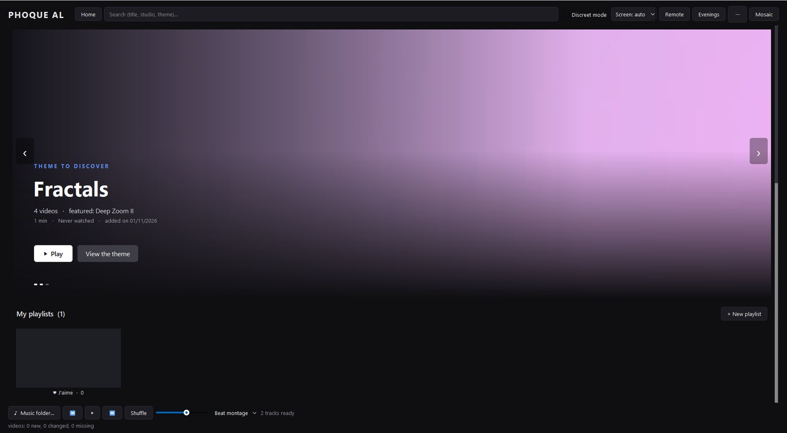
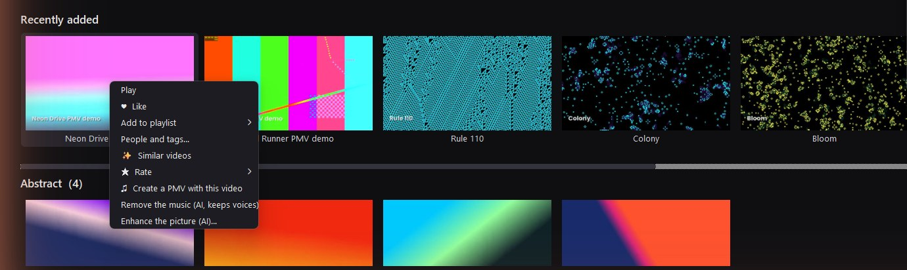
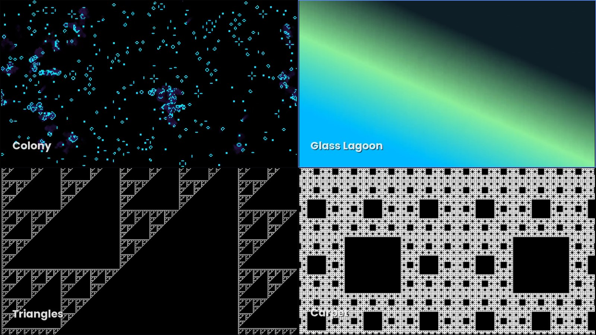
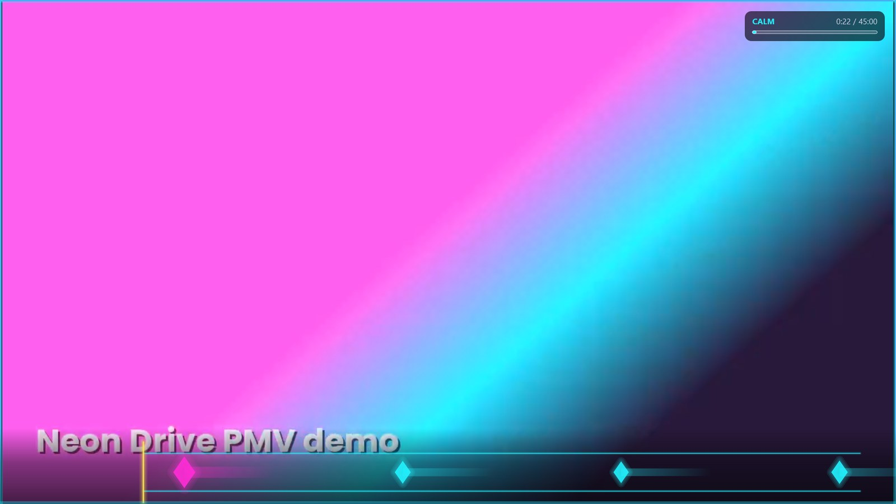
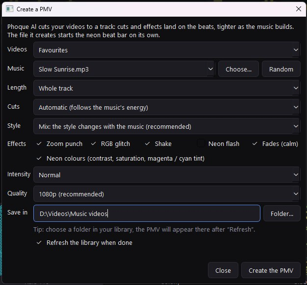
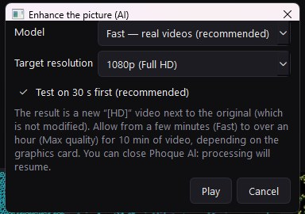
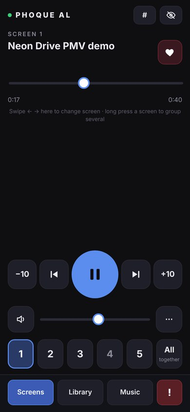
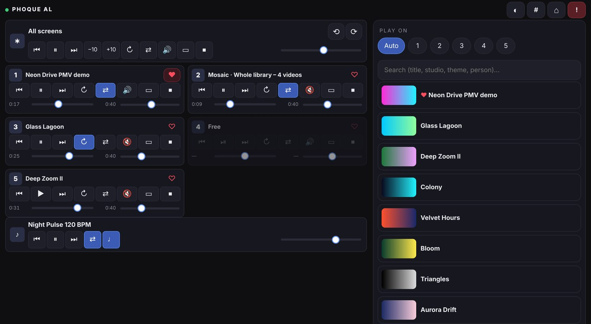

# Phoque Al

**Your local video library, streaming-style — on as many screens as you have.**



Phoque Al is a free, open-source Windows application that turns the folders of videos on your drives into a
streaming-service-like library, then plays them on up to nine screens at once — with music-synced montages, a
phone remote and local AI tools. No account, no cloud, no telemetry: everything stays on your PC.

[**⬇ Download for Windows**](../../releases/latest) · [**📖 User guide**](docs/USER_GUIDE.md) ·
English · Français · Español · Deutsch

---

## Highlights

### A home page you actually want to browse
A featured banner with live previews, *Resume*, *Favourites*, *Recommended for you*, playlists, top rated,
people & tags, recently added — and one row per theme (each sub-folder is a theme). Hover a thumbnail for a
preview, right-click it for everything else.



### Built for several screens
Up to **9 screens** playing different videos at the same time, a mini-map to pick a screen, keys `1`–`9` to jump
between players, global controls with `Shift`, and one-key *shift every video to the next screen*.
**Mosaics** put 2 to 16 videos on one screen; the **video wall** spreads one video across several screens with
bezel compensation; **Evenings** save and relaunch a whole setup in one click.



### Everything moves with the music
Play your own music and the **beat montage** changes the videos on the beat, faster when the track builds up.
A **neon beat bar** pulses under music videos. **Sessions** run timed programmes (calm → intense → cool-down…)
with an on-screen timer.



### Make your own music videos
Pick a track and some videos — or your favourite moments, or the automatically detected highlights — and the
generator cuts them on the beat in 8 styles (stutter, split screen, grid, mirror, pulse, speed ramps…), with zoom
punches, glitches and neon colours. The result has separate *music* and *video sounds* audio tracks.



### Local AI tools — optional, private, on your own PC
| | |
|---|---|
| **Tag suggestions** | A CLIP model watches a few frames of each video and proposes tags from *your* list; it learns from what you accept. |
| **Music removal** | An MDX-Net model separates the music from voices in existing videos, so they never clash with your own music. |
| **Picture enhancement** | Real-ESRGAN on your graphics card upscales and cleans low-quality videos into a new "[HD]" file. |



### Control it from the couch
A **phone / tablet remote** in the browser — no app to install, QR code + PIN — with a one-hand portrait mode
and a full multi-screen tablet layout. Also: Xbox-compatible **game controllers**, **satellite PCs** that add
their screens and library over the network, and fully remappable keyboard shortcuts.

<p>

&nbsp;

</p>

### Private by design
**Discreet mode** (no thumbnails, neutral titles, on the PC and the phone), a **panic key** (`F12`: everything
paused and hidden), optional start with Windows minimised and discreet. Your library, history and AI models live
in the program's own `data` folder; nothing is ever uploaded.

### And also
Favourite moments and reels · highlight detection · scene detection · transitions · 1–5 star ratings ·
playlists · people & tags from file names · photo albums (folders, ZIP / RAR / CBZ) · exact and visual duplicate
finder · statistics · blurred-background fill and crop modes for any screen shape · external drives recognised by
serial number.

👉 Every feature is explained step by step in the [**user guide**](docs/USER_GUIDE.md).

---

## Installation

1. Download `PhoqueAl_Setup.exe` from the [latest release](../../releases/latest).
2. Run it — no administrator rights needed. VLC and FFmpeg are included.
3. Open **⋯ → Settings → Library → Add a source folder…** and pick your video folders.

**Requirements**: Windows 10 or 11, 64-bit. A Vulkan-capable graphics card for AI picture enhancement.
AI models are downloaded the first time you use a feature (from GitHub or Hugging Face).

## Running from source

```bat
git clone https://github.com/pierreoliviermarcel-ui/phoque-al.git
cd phoque-al
lancer_phoqueal.bat
```

Needs Python 3.11+, VLC 64-bit, and FFmpeg on the `PATH` (`winget install Gyan.FFmpeg`).
`build_windows.bat` builds the installer (PyInstaller + Inno Setup).

| Path | Content |
|---|---|
| `phoqueal/` | the application: PySide6 interface, libVLC players, SQLite library |
| `phoqueal/extras/` | optional features, one module each, plugged in at start-up |
| `phoqueal/extras/i18n.py`, `i18n_data.py` | runtime translation (French source strings → EN / ES / DE) |
| `docs/` | user guide, screenshots, PDF guide generator (French) |
| `installer/` | Inno Setup script |
| `tools/download_models.py` | pre-downloads the AI models for offline machines |

## Contributing

Bug reports, translations and pull requests are welcome. Fork, work on a branch, open a pull request.
Source strings are in French; to add or fix a translation, edit `phoqueal/extras/i18n_data.py`
(`French text: (English, Spanish, German)`). A new feature usually fits in a new module in `phoqueal/extras/`.

## License

**GNU General Public License v3.0 or later** — see [LICENSE](LICENSE). You may use, study, modify and share it;
distributed modified versions must stay under the GPL.
Third-party components keep their own licenses: see [THIRD_PARTY_NOTICES.md](THIRD_PARTY_NOTICES.md).

Phoque Al plays and organises your own files; it does not provide, download or host any videos.
Screenshots show generated demo content.
