# Phoque Al — User guide

This guide walks through every part of Phoque Al. For a quick overview, see the [README](../README.md).

**Contents**

1. [First start](#1-first-start)
2. [The home page](#2-the-home-page)
3. [Playing videos](#3-playing-videos)
4. [Several screens](#4-several-screens)
5. [Mosaics](#5-mosaics)
6. [Video wall](#6-video-wall)
7. [Evenings](#7-evenings)
8. [Background music and the beat montage](#8-background-music-and-the-beat-montage)
9. [The neon beat bar](#9-the-neon-beat-bar)
10. [Music-video generator](#10-music-video-generator)
11. [Sessions](#11-sessions)
12. [Moments, highlights and scenes](#12-moments-highlights-and-scenes)
13. [People, tags and AI tag suggestions](#13-people-tags-and-ai-tag-suggestions)
14. [AI sound tools: music removal and ducking](#14-ai-sound-tools-music-removal-and-ducking)
15. [AI picture enhancement](#15-ai-picture-enhancement)
16. [Phone and tablet remote](#16-phone-and-tablet-remote)
17. [Satellite PCs](#17-satellite-pcs)
18. [Game controller](#18-game-controller)
19. [Privacy: discreet mode, panic key, your data](#19-privacy-discreet-mode-panic-key-your-data)
20. [Duplicates, statistics and other tools](#20-duplicates-statistics-and-other-tools)
21. [Settings and language](#21-settings-and-language)
22. [Keyboard shortcuts](#22-keyboard-shortcuts)
23. [Troubleshooting](#23-troubleshooting)

---

## 1. First start

1. Install with `PhoqueAl_Setup.exe` (no administrator rights needed) and open Phoque Al.
2. Open **⋯ → Settings → Library → Add a source folder…** and pick a folder that contains your videos.
   You can add as many folders as you like, on internal or external drives.
3. Click **Save**. The library is scanned, thumbnails and previews are generated in the background.

Each **sub-folder becomes a theme** (a row on the home page). Untick a sub-folder in the same tab to hide it from
the library — files are never touched.

> **External drives**: drives are recognised by their serial number, not their letter. Unplug a drive and its
> videos simply show as unavailable; plug it back in (even as another letter) and everything comes back,
> including your history, likes and ratings.

## 2. The home page

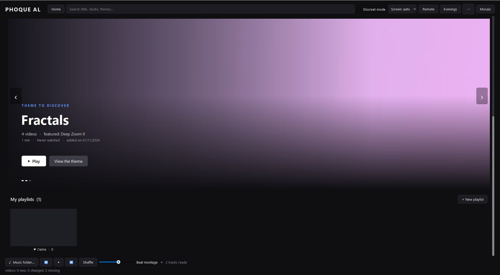

- **Banner**: up to 8 featured slides with a live video preview — a random video, *Resume*, *Your favourites*,
  a *featured theme*, a *suggested video*. Choose the slide types and their number in **⋯ → Home**.
  Keys: `PgDown` / `PgUp` (next / previous slide), `Ctrl+L` (play), `Ctrl+E` (play the theme on all screens).
- **Rows**, in a recommended order (can be turned off in **⋯ → Home**): Resume, Favourites, Recommended for you,
  Playlists, Evenings, Moments, Top rated, People & tags, Recently added, Photo albums, then one row per theme.
- **Hover a thumbnail** to see a short animated preview (video previews on SSDs, image previews on hard drives —
  see **⋯ → Previews**).
- **Right-click a thumbnail** for everything you can do with a video:

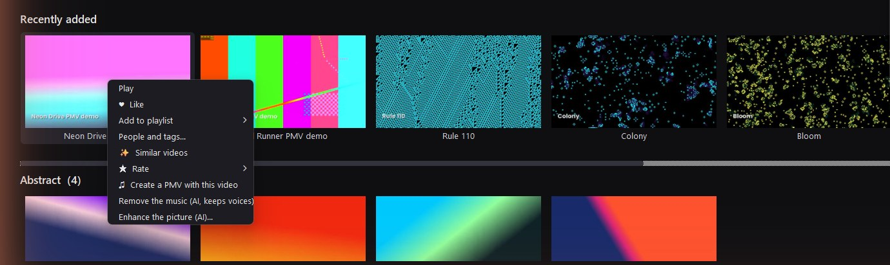

- `Ctrl` / `Shift` + click selects several thumbnails; the right-click menu then applies to all of them.
- Right-click a row title to set it as your **favourite theme** (it gets its own banner slide).

## 3. Playing videos

Double-click a thumbnail (or **Play**). The video opens full screen on the next free screen — or on the screen
chosen in the **Screen** drop-down of the top bar.

- The **active player** has a blue frame; the keyboard acts on it. `Esc` closes it and remembers the position.
- **Aspect ratio** (`C`): original with black bars, *fill the screen* (automatic crop to the exact shape of that
  screen — ideal with screens of different formats), or fixed formats 16:9, 21:9, 16:10, 4:3, 5:4, 1:1, 9:16,
  or stretch.
- **Blurred background** (`B`): fills the black bars with a blurred copy of the picture.
- **When a video ends**: next video of the theme / playlist, replay, or stop. Each theme can behave as a playlist.
- **Transitions** between videos (`T` cycles): crossfade, fade to black, white flash, slide, zoom, blur.
- **Info** (`I`): title, time and volume on screen.
- **Mouse-mode remote** (`Ctrl+T`): a small movable control panel for all screens.

## 4. Several screens

Phoque Al is designed for **1 to 9 screens** used at the same time.

- Every screen can play its own video with its own sound. Keys `1` … `9` jump to the player of a screen, `0`
  goes back home. `Shift` + a player key acts on **all** players at once (pause, seek, volume, mute…).
- **Screen numbers**: **⋯ → My screens (numbers)…** lets you choose which physical screen is number 1, 2, 3…
  The screens display their number while you set this up.
- **Choosing a screen**: when all screens are busy, Phoque Al asks where to play. With 4 screens or more the
  question is shown as a **mini-map of your real screen layout** (can be turned off in the ⋯ menu).
- **Shift videos**: `Shift+R` moves every video one screen further (1 → 2 → 3 → 1), `Shift+E` the other way.
- **Groups** (phone remote): long-press several screens to control them together.

## 5. Mosaics

A mosaic plays several videos on one screen — 2, 3, 4, 6, 8, 9, 12 or 16.

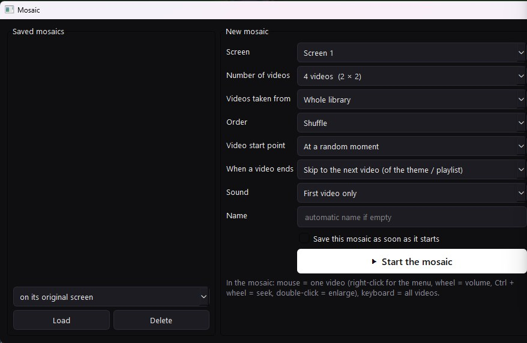

Choose the screen, the number of videos, where they come from (whole library, a theme, a playlist, a person or a
tag), the order, where each video starts, what happens at the end, and which cells have sound.
Save the mosaic to relaunch it later in one click.

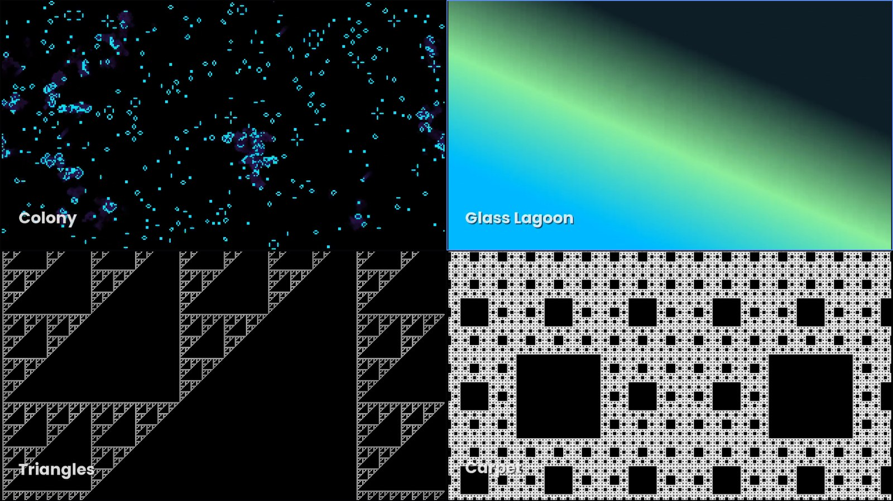

Inside a mosaic, **the mouse controls one cell** (right-click for its menu, wheel = volume, `Ctrl` + wheel =
seek, double-click = enlarge it) and **the keyboard controls all cells**.

## 6. Video wall

**⋯ → Video wall…** spreads one video across several screens, as if they were one big display.

- Drag each screen to its real place on the diagram; sizes are read from the screens and can be edited.
- The video is cut so that it lines up across the **bezels**. Start the **test pattern** to check that lines stay
  straight from one screen to the next.
- Choose to see the whole picture or to fill the whole wall (crops a little). Walls can be saved.

## 7. Evenings

**Evenings** (top bar) saves the whole current setup — which video or mosaic plays on which screen, the music,
the montage — and relaunches it in one click, from the PC or from the phone. *Update with the current setup*
overwrites a saved evening.

## 8. Background music and the beat montage

- **Music folder…** (bottom bar) picks a folder of audio files (MP3, M4A, AAC, WAV, FLAC, OGG, OPUS, WMA).
  The music plays everywhere, with its own volume, shuffle and next / previous track (`Ctrl+Space`, `Ctrl+N`,
  `Ctrl+B`, `Ctrl+Up` / `Ctrl+Down`).
- **Beat montage** (`Ctrl+R`): the tempo of the track is detected and the videos on screen **change on the beats**
  — every beat, every 2 beats, every bar… or automatically, faster when the music builds up. Options: start
  each clip at a scene start, at a highlight or at one of your favourite moments; mute the videos during the
  montage; apply it to mosaics too.

## 9. The neon beat bar

A cyberpunk-style animated bar at the bottom of the main screen that follows the beat of music videos
(videos tagged or named *pmv*) and of the beat montage.

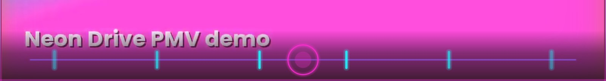

- Styles (`Shift+Y`): *Convergence*, *Scrolling*, *Synthwave highway*, *Counter*.
- Effects: pulsing neon border, vignette, scan lines, glitch on strong beats, optional flash (off by default —
  careful if you are sensitive to flashing light).
- Offset (`Alt+←` / `Alt+→`, 20 ms steps) if the bar looks early or late on your system.
- `Y` shows / hides it for the current video. Settings: **⋯ → Rhythm (neon bar, PMV)**.

## 10. Music-video generator

**⋯ → Create a PMV…** (or right-click a video → *Create a PMV with this video*) cuts videos to a music track:
cuts and effects land on the beats, tighter as the music builds.

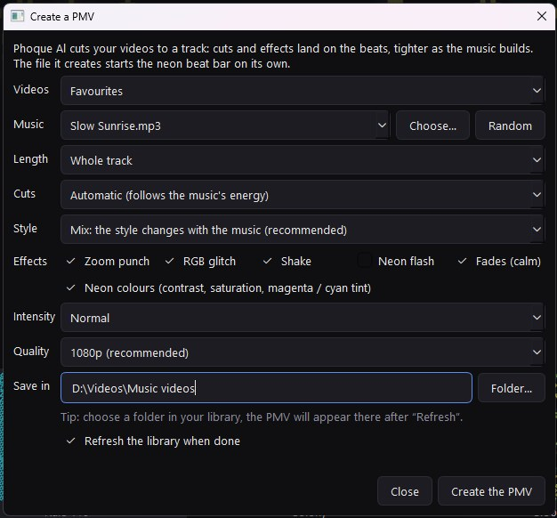

- **Videos**: favourites, a theme, a playlist, the selection, your favourite moments, or the highlights.
- **Styles**: classic, stutter, split screen, 2×2 grid, mirror / kaleidoscope, pulse (zoom on each beat),
  slow-mo / turbo, and *mix* (the style follows the music).
- **Effects**: zoom punch, RGB glitch, shake, neon flash, fades, neon colours. Intensity and quality are adjustable.
- The result is an MP4 with **three audio tracks** — *music and video sounds*, *music only*, *video sounds only* —
  and it starts the neon bar by itself.
- **⋯ → Compilation of my favourite moments** builds one from your marked moments.

## 11. Sessions

**⋯ → Session…** runs a timed programme on top of the beat montage. Each phase sets the cut speed and the volume.

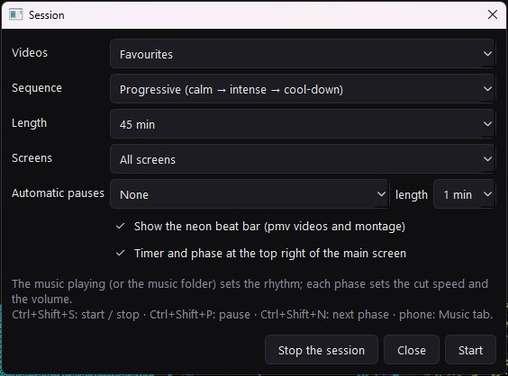

- Sequences: *Progressive* (calm → intense → cool-down), *Waves*, *Slow build*, *Free* (endless) and a
  *guided build-up / slow-down / stop* sequence with ever longer cycles.
- Length, screens, automatic pauses, neon bar, and an on-screen **timer and phase**:

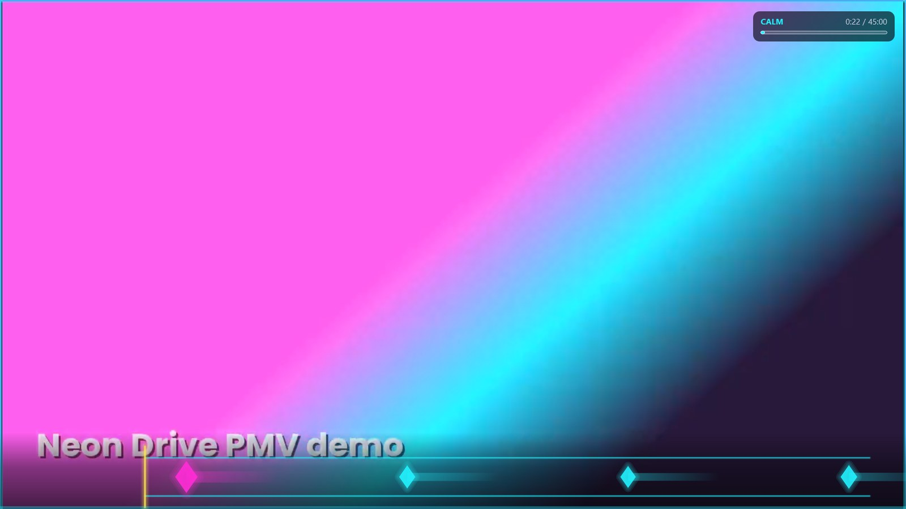

- `Ctrl+Shift+S` start / stop, `Ctrl+Shift+P` pause, `Ctrl+Shift+N` next phase — also from the phone (Music tab).

## 12. Moments, highlights and scenes

- **Favourite moments**: press `K` during a video to mark the instant, `J` to jump to the next marked moment.
  *My favourite moments* lists them all; the **reel** plays them one after another.
- **Highlights**: the most intense passages of each video, found from motion and sound energy. `H` / `Shift+H`
  jump between them. The montage, sessions and generator can start from them. The analysis runs when a video is
  played, or for the whole library in the background (**⋯ → Hot passages**).
- **Scenes**: scene changes are detected; `PgDown` / `PgUp` in a player jump to the next / previous scene.

## 13. People, tags and AI tag suggestions

- **People & tags workshop** (⋯ menu): Phoque Al reads your file names and proposes people's names and tags.
  Confirm, reject, merge names, add aliases and keywords; what you confirm is recognised in every file, even
  when words are glued together. Right-click a video → *People and tags…* to edit one video.
- **AI tag suggestions** (**⋯ → Suggested tags**): a local CLIP model (≈ 155 MB, downloaded once) looks at a few
  frames of each video and proposes tags from a list **you** define (*Tag list…*, one line per tag:
  `Name = description in English`; `#` starts a group of exclusive choices). Accept or reject; the model learns
  from your answers. Automatic application above 85 / 90 / 95 % confidence is optional, and can be undone.

## 14. AI sound tools: music removal and ducking

- **Ducking** (**⋯ → PMVs during my music**): while your own background music plays, music videos switch to
  their *video sounds only* track, or are muted / lowered to 15 % if they have none. `U` forces it on / off for
  the current video. Everything goes back to normal when your music stops.
- **AI music removal** (**⋯ → Sound: AI separation**, or right-click → *Remove the music*): an MDX-Net model
  (≈ 64 MB, downloaded once) separates the music from voices and other sounds of an existing video. The result
  is a small separate sound file — **your video is never modified** — added as an extra audio track at playback,
  which the ducking then uses. It can run for all music videos in the background (favourites first).
  It keeps voices best; a singer in the song is also kept, and some non-vocal sounds are reduced.
  Processing runs on the processor and takes a few minutes per video.

## 15. AI picture enhancement

Right-click a video → **Enhance the picture (AI)…**

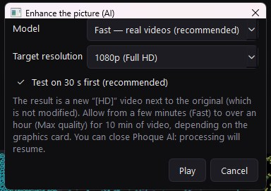

- Engine: **Real-ESRGAN** running on the graphics card through Vulkan (NVIDIA, AMD or Intel). The card is
  detected and shown in the window.
- Models: **Fast** (recommended for real footage), **Max quality** (4–8 × slower), and one for cartoons.
- Target: 1080p, 1440p, 4K, or *same size* (cleaned picture only).
- A **30-second test** is made first, so you can judge before processing the whole video.
- The result is a new file `name [HD].mp4` next to the original (or in *Videos\Phoque Al HD* if that folder is
  read-only), with the original sound. Work is done in 10-second chunks: you can close Phoque Al and it resumes.
- Follow progress, cancel or retry in **⋯ → Picture: AI enhancement**. Option: pause while videos are playing.
- Expect a few minutes (Fast) to more than an hour (Max quality) for 10 minutes of video, depending on the card.
  It helps most with low-resolution or heavily compressed videos.

## 16. Phone and tablet remote

1. **⋯ → Phone**, tick *Enable the phone / tablet remote*.
2. Scan the **QR code** with the phone (same Wi-Fi), or type the address shown, then the **6-digit code**.
3. Tip: in the phone browser, *Add to Home screen* to open it like an app.

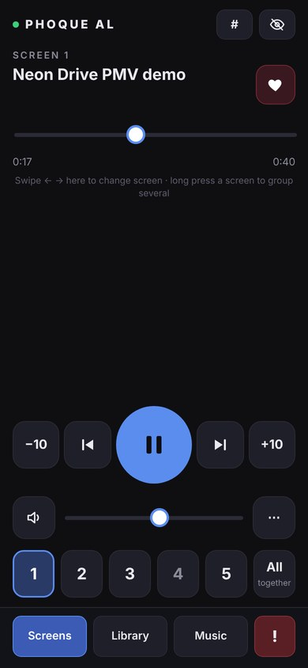
&nbsp;
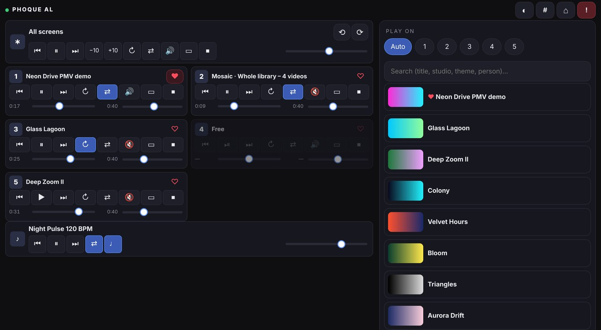

- **Phone (portrait)**: one-hand layout — swipe ← → to change screen, long-press screens to group them,
  big play / seek buttons, volume, like, rating, aspect ratio, blur, moments, scenes, stop.
- **Tablet / landscape**: all screens at once, plus the library (search, playlists, themes, evenings) and the music.
- **Library tab**: play any video, playlist or theme on a chosen screen, or spread it across all screens.
- **Music tab**: background music, beat montage, neon bar and sessions.
- The red **!** button is the panic key.
- If the phone cannot connect, click **Allow through firewall** in the same window (Windows asks for
  confirmation). Without a router, turn on the phone's hotspot and connect the PC to it.
- **New code** disconnects all phones (they have to scan again).

## 17. Satellite PCs

A **satellite** is another computer running Phoque Al with its own library — for example a laptop connected by
Ethernet cable. Its screens become extra screens of the main PC and its videos appear on the home page.

1. On the satellite: open Phoque Al, click **Phone** (this starts its server) and note its 6-digit code.
2. On the main PC: **⋯ → Settings → Library → Satellite computers… → Search the network**, choose it, type the code.
   (Or *Add by IP address* if it is not found.)

## 18. Game controller

Xbox-compatible controllers (XInput) can drive the players: play / pause, seek, volume, next, screen switching…
Buttons can be reassigned in **⋯ → Game controller → Controller buttons…**.

## 19. Privacy: discreet mode, panic key, your data

- **Discreet mode** (`Ctrl+D`, top bar): no thumbnails, no banner, neutral titles ("Video 3", "Collection 2")
  on the PC and on the phone.
- **Panic key** (`F12`, or **!** on the phone): everything is paused and hidden at once; `F12` again brings it back.
- **Start with Windows** (**⋯ → Windows startup**): optionally minimised and in discreet mode.
- **Your data stays local**: the library database, thumbnails, previews, AI models and separated sounds are in
  the `data` folder of the installation. Nothing is sent anywhere. The only network access is the optional
  download of AI models (GitHub / Hugging Face) and, if you enable them, the phone remote and satellites on your
  local network. Uninstalling keeps the `data` folder.

## 20. Duplicates, statistics and other tools

- **Find duplicates** (Settings → Library): exact duplicates (identical files) and probable duplicates
  (same length). **Visual duplicates** (⋯ menu) compares the *picture* to find the same video in several
  qualities; the best version is kept by default. Removed copies go to a `_Corbeille_Focal` recycle folder on
  their drive — nothing is deleted until you empty it.
- **Statistics**: watching time, most watched themes, people and videos, rating breakdown.
- **Photo albums**: image folders and ZIP / RAR / CBZ / CBR archives (RAR needs 7-Zip or WinRAR installed),
  shown as albums or mixed into themes and montages.
- **Playlists**: drag to reorder, play from any video, copy, rename. Likes form a playlist of their own.

## 21. Settings and language

- **⋯ → Settings**: *Library* (sources, duplicates, satellites), *Display* (hover previews, banner size, blurred
  background, default aspect ratio, start point of videos…), *Photos*, *Keyboard* (every shortcut can be
  changed; conflicts are shown).
- **⋯ → Langue / Language**: Français, English, Español, Deutsch (restart to apply everywhere). By default,
  the language of Windows is used.

## 22. Keyboard shortcuts

All keys can be changed in **Settings → Keyboard**.

**Everywhere**

| Action | Key |
|---|---|
| Back to home | `0` |
| Go to the player on screen 1 … 9 | `1 … 9` |
| All players: pause / play | `Shift+Space` |
| All players: back 10 s | `Shift+Left` |
| All players: forward 10 s | `Shift+Right` |
| All players: volume + | `Shift+Up` |
| All players: volume − | `Shift+Down` |
| All players: mute / unmute | `Shift+M` |
| Close all players | `Shift+Esc` |
| Shift videos by one screen (1 → 2 → 3 → 1) | `Shift+R` |
| Shift videos the other way (3 → 2 → 1 → 3) | `Shift+E` |
| All players: blurred background on the edges | `Shift+B` |
| All players: change aspect ratio | `Shift+C` |
| Panic key (hide everything) | `F12` |
| Discreet mode: on / off | `Ctrl+D` |
| Remote (mouse mode): show / hide | `Ctrl+T` |

**Player**

| Action | Key |
|---|---|
| Pause / play | `Space` |
| Back 10 s | `Left` |
| Forward 10 s | `Right` |
| Back 1 min | `Ctrl+Left` |
| Forward 1 min | `Ctrl+Right` |
| Volume + | `Up` |
| Volume − | `Down` |
| Mute / unmute | `M` |
| Full screen / window | `F` |
| Show info | `I` |
| Close the player | `Esc` |
| Like / unlike this video | `L` |
| Blurred background on the edges: on / off | `B` |
| Aspect ratio: change (black bars, fill, 4:3…) | `C` |
| Playlist: next video | `N` |
| Playlist: previous video | `P` |
| Next hot passage | `H` |
| Previous hot passage | `Shift+H` |
| PMV: remove / restore the video's music | `U` |
| Favourite moment: mark the current instant | `K` |
| Go to this video's next favourite moment | `J` |
| Beat bar: show / hide | `Y` |
| Beat bar: next style | `Shift+Y` |
| Beat bar: shift earlier (−20 ms) | `Alt+Left` |
| Beat bar: shift later (+20 ms) | `Alt+Right` |
| Rate 1 star | `Alt+1` |
| Rate 2 stars | `Alt+2` |
| Rate 3 stars | `Alt+3` |
| Rate 4 stars | `Alt+4` |
| Rate 5 stars | `Alt+5` |
| Remove the rating | `Alt+0` |
| Next scene | `PgDown` |
| Previous scene | `PgUp` |
| Transition between videos: change effect | `T` |

**Background music**

| Action | Key |
|---|---|
| Music: play / pause | `Ctrl+Space` |
| Music: next track | `Ctrl+N` |
| Music: previous track | `Ctrl+B` |
| Music: volume + | `Ctrl+Up` |
| Music: volume − | `Ctrl+Down` |
| Beat montage: on / off | `Ctrl+R` |

**Mosaic**

| Action | Key |
|---|---|
| Save the mosaic | `Ctrl+S` |

**Home**

| Action | Key |
|---|---|
| Banner: next slide | `PgDown` |
| Banner: previous slide | `PgUp` |
| Banner: play the featured video | `Ctrl+L` |
| Banner: play the theme on all screens | `Ctrl+E` |

**Sessions**

| Action | Key |
|---|---|
| Session: start / stop | `Ctrl+Shift+S` |
| Session: pause / resume | `Ctrl+Shift+P` |
| Session: next phase | `Ctrl+Shift+N` |

## 23. Troubleshooting

| Problem | What to do |
|---|---|
| A video shows as unavailable | Its drive is unplugged or its folder moved. Plug the drive back in, or *Refresh*. |
| No sound / no picture | Phoque Al uses VLC (bundled in the installer). From source, install VLC 64-bit. |
| The phone cannot connect | Same Wi-Fi? Click *Allow through firewall* in the Phone window. Some guest Wi-Fi networks block devices from seeing each other. |
| The neon bar is early / late | Adjust the offset with `Alt+←` / `Alt+→`. |
| AI picture enhancement fails | Update the graphics card driver (Vulkan support). Try the *Fast* model and a lower target. |
| An AI model cannot be downloaded | The PC needs internet the first time. On an offline PC, copy the `data\models` folder from another installation. |
| Thumbnails are missing | FFmpeg is required (bundled in the installer; from source: `winget install Gyan.FFmpeg`). |
